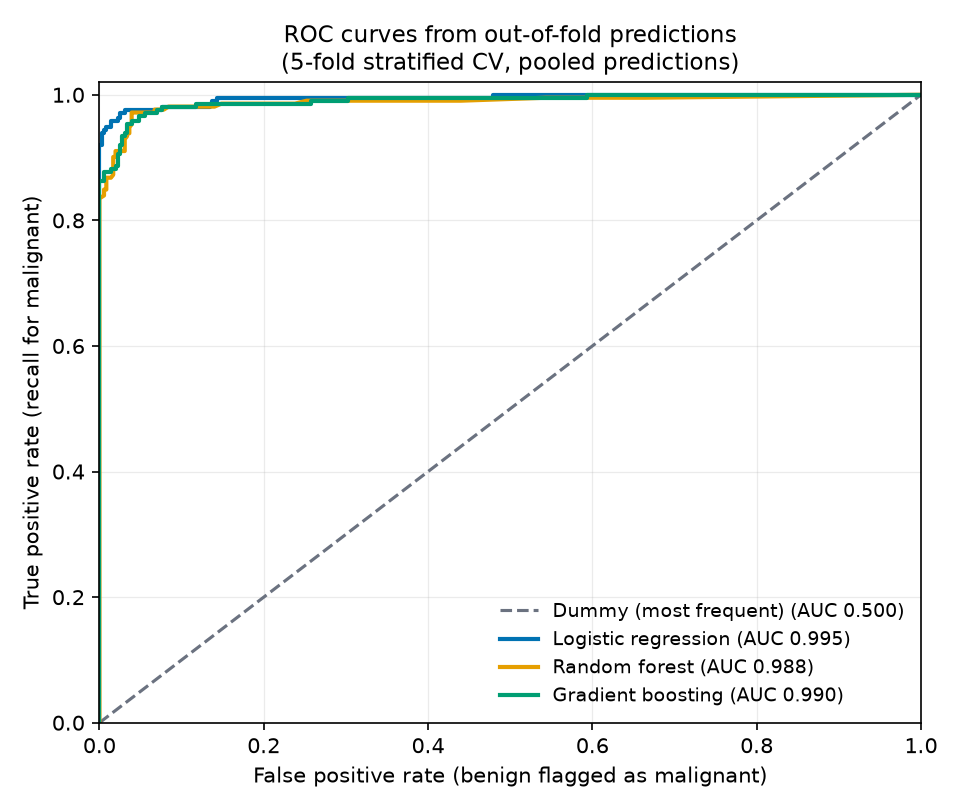
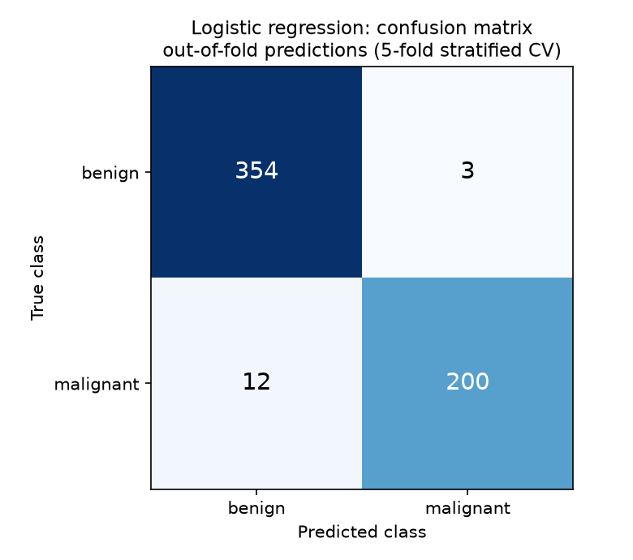

# ml-model-evaluation

A small educational project on how to evaluate a machine-learning model correctly: baselines, repeated stratified cross-validation, and data leakage.

It uses scikit-learn's built-in Breast Cancer Wisconsin (Diagnostic) dataset. The dataset is public, ships with scikit-learn and needs no download or account. **This is an educational project, not a clinical tool.**

## Why this project exists

A model score is only worth something if the evaluation is honest. This repo shows three habits in a few hundred lines of code:

- **Baselines first.** A model is compared against a dummy classifier and a plain logistic regression, so "good" has a reference.
- **Repeated stratified k-fold CV.** Mean and standard deviation over many folds instead of one lucky split.
- **No leakage.** All preprocessing (scaling, feature selection) sits inside a scikit-learn `Pipeline`, so it is fitted on training folds only. A leakage experiment compares the wrong way with the right way and reports what actually happened.

## How to run

```
make install
make test
make run
```

`make run` writes tables, plots and a log to `results/`. On the author's laptop it takes about half a minute. `make lint` runs ruff.

The pipelines are in `src/mleval/pipelines.py`, the cross-validation code in `src/mleval/evaluation.py`, the leakage experiments in `src/mleval/leakage.py`, and the script that produces everything in `scripts/run_experiments.py`.

## Results

Data: 569 rows, 30 features, malignant (positive class) = 212. Cross-validation: repeated stratified 5-fold x 10 (50 folds), seed 42. **Malignant is the positive class**, so recall means "what share of malignant cases was caught". Cells are mean +/- standard deviation over the 50 folds.

| Model | ROC AUC | Recall | Precision | F1 |
|---|---|---|---|---|
| Dummy (most frequent) | 0.5000 +/- 0.0000 | 0.0000 +/- 0.0000 | 0.0000 +/- 0.0000 | 0.0000 +/- 0.0000 |
| Logistic regression | 0.9948 +/- 0.0054 | 0.9576 +/- 0.0339 | 0.9856 +/- 0.0153 | 0.9711 +/- 0.0200 |
| Random forest | 0.9898 +/- 0.0089 | 0.9344 +/- 0.0483 | 0.9563 +/- 0.0351 | 0.9441 +/- 0.0283 |
| Gradient boosting | 0.9911 +/- 0.0086 | 0.9316 +/- 0.0425 | 0.9596 +/- 0.0326 | 0.9445 +/- 0.0257 |

Source: `results/results_table.md`. No hyperparameters were tuned.

How to read it:

- **Dummy (most frequent)** always predicts benign, the majority class. It never predicts malignant, so its recall, precision and F1 are 0.0000 (precision and F1 use `zero_division=0`). Its ROC AUC is 0.5000.
- **Logistic regression is best on every metric** in this table.
- **Random forest and gradient boosting** differ from each other by less than the fold-to-fold standard deviation, so I do not rank them.
- **The standard deviation is computed over overlapping folds.** Folds from repeated CV share training data, so it describes spread across folds. It is not a confidence interval.

### Plots

Both plots use out-of-fold predictions from a single stratified 5-fold split (every row is predicted by a model that never saw it), pooled over the folds. They are not the 50-fold averages from the table.



The three models are close together in the top-left corner, so the curves overlap there.



In this single split, logistic regression missed 12 of 212 malignant cases (200 were caught) and flagged 3 benign cases as malignant. The recall in the table above is 0.9576. The two views differ because the table averages recall over 50 folds, while the confusion matrix pools the predictions of one 5-fold split. They are different estimates of the same model on the same small dataset, not a contradiction. 12 missed malignant cases is the kind of error that matters in this setting.

## The leakage experiment

**Leakage** means information from the test data influences the model or its preprocessing. The classic mistake is to scale or select features on the whole dataset first and cross-validate afterwards: the preprocessing has then already seen the rows (and, for feature selection, the labels) of every test fold.

- **WRONG:** fit the preprocessing on all rows, then cross-validate.
- **RIGHT:** put the same preprocessing in one `Pipeline`, so it is refitted on the training part of every fold.

Both ways use the same logistic regression, the same folds (repeated stratified 5-fold x 10, seed 42) and the same metrics. The "gap" column is wrong minus right.

### Experiment A: real data

StandardScaler plus `SelectKBest` (k=10 of the 30 features) before logistic regression. REAL data.

| Metric | Wrong mean | Wrong std | Right mean | Right std | Gap (wrong - right) |
|---|---|---|---|---|---|
| roc_auc | 0.9878 | 0.0087 | 0.9877 | 0.0087 | +0.0000 |
| recall | 0.9278 | 0.0439 | 0.9283 | 0.0443 | -0.0005 |
| precision | 0.9467 | 0.0306 | 0.9467 | 0.0313 | -0.0000 |
| f1 | 0.9364 | 0.0276 | 0.9366 | 0.0284 | -0.0003 |

**The gap is about zero.** I am reporting that as it came out. The likely reason (I did not measure which features get selected): the real features carry strong signal, so the selector probably picks nearly the same 10 features whether it sees all rows or only the training rows of a fold. With strong real features, fitting the scaler and selector on all rows changes little. This does **not** show that leakage is harmless. It shows that this dataset is too easy to reveal it.

### Experiment B: SYNTHETIC data

This experiment uses **SYNTHETIC data**, not real patient data: a 569 x 500 matrix of pure random noise (fixed seed), paired with the real labels. The features have no relation to the labels, so an honest evaluation should score about chance (ROC AUC 0.5000). `SelectKBest` (k=10) picks 10 of the 500 noise columns, then logistic regression is trained. All numbers below are from SYNTHETIC data.

**SYNTHETIC data, 569 x 500 pure noise features with the real labels:**

| Metric | Wrong mean | Wrong std | Right mean | Right std | Gap (wrong - right) |
|---|---|---|---|---|---|
| roc_auc | 0.6654 | 0.0516 | 0.4737 | 0.0386 | +0.1917 |
| recall | 0.3664 | 0.0580 | 0.2160 | 0.0565 | +0.1505 |
| precision | 0.6129 | 0.0940 | 0.3473 | 0.0705 | +0.2656 |
| f1 | 0.4544 | 0.0578 | 0.2643 | 0.0601 | +0.1901 |

- **WRONG way (SYNTHETIC):** selecting the 10 "best" noise columns using all labels first gives ROC AUC 0.6654 on pure noise, well above 0.5000. Among 500 random columns some correlate with the labels by chance, and selecting them on all rows lets that chance correlation leak into the test folds.
- **RIGHT way (SYNTHETIC):** selection inside the pipeline gives ROC AUC 0.4737, about chance. It is slightly below 0.5000. A value below chance on pure noise is a known effect under cross-validation; I did not investigate it further.

Source: `results/leakage.md` (also `results/leakage_real.csv` and `results/leakage_synthetic.csv`, which carry a `data` column with `real` or `synthetic`).

## Why recall matters here

In a medical screening setting a missed malignant case (a false negative) is usually far worse than a false alarm (a false positive). Recall is the share of malignant cases the model catches, so it is the metric that exposes missed cases. Accuracy would hide them because benign cases are the majority. That is why this project reports recall, precision, F1 and ROC AUC together, and uses malignant as the positive class. This project does not tune a decision threshold for recall.

## Limitations

- **Public, small, easy dataset.** 569 rows, and even simple models score high. This is why leakage experiment A shows no visible difference.
- **Not a clinical tool.** This is an educational project and must not be used for any medical decision.
- **Results will not transfer to real clinical data.** Real data is messier, differently distributed and often much harder.
- **No hyperparameter tuning and no nested cross-validation.** Models use mostly default settings, so the model comparison is only a rough one.
- **No calibration or threshold tuning.** Predictions use the default 0.5 decision threshold.
- **No external validation.** Everything is evaluated by cross-validation on one dataset.
- **One seed for the committed results** (42). Other seeds will give somewhat different numbers.
- **Dependencies are not pinned,** only lower bounds are set in `requirements.txt`.
- **CI:** a GitHub Actions workflow (`.github/workflows/ci.yml`) is defined for Python 3.10 and 3.13. I have not yet confirmed that it passes on GitHub. Locally the project was run on Python 3.13 only.

## Versions

The committed results in `results/` were produced with Python 3.13.7, numpy 2.5.4, pandas 3.0.6, scikit-learn 1.9.1 and matplotlib 3.11.2. Other versions may change the last digits.
